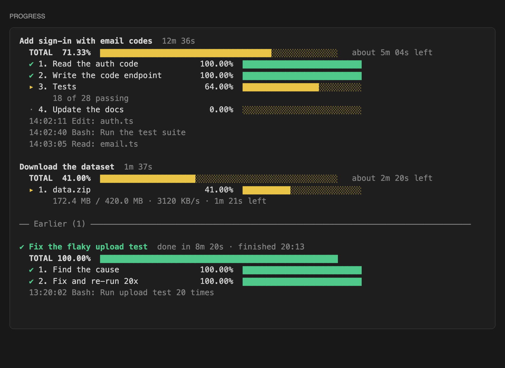
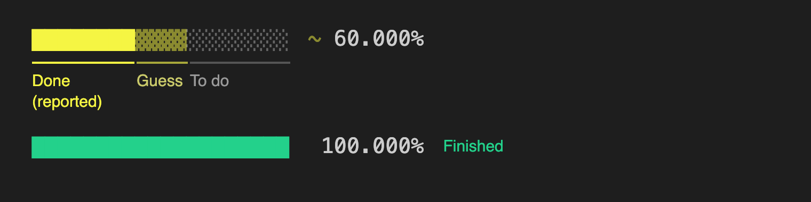

# Progress Terminal for Claude Code

See what Claude Code is doing while it works. One terminal in VS Code, called Progress, shows every task with its steps, a percentage and the time left, updated every second.



## What it shows

The Progress terminal opens by itself when Claude Code starts working, and your cursor stays where it was, so you can keep typing. Several tasks at once each get their own section in the same terminal.

When Claude Code splits a task into steps, you see each step's percentage, to three decimals, and the time left. Between the numbers Claude Code reports, an estimate keeps moving every second while work is really going on: a tool call or an agent running, or something happening in the last 90 seconds. Estimated numbers have a "~" in front and a lighter part in the bar. They never go backwards and never reach 100% before the step is done, and when Claude Code reports a number far ahead, the display counts up to it instead of jumping. When nothing is happening the numbers stop, and a "now:" line under the total says what is going on, for example "no tool activity for 1m 40s · numbers paused", or "may be stuck" after 10 minutes without news. The time left is worked out from reported numbers only, and is left out when it cannot be trusted.

### Reading a bar



- **Done**: what Claude Code has reported.
- **Guess**: the estimate on top of it, the same guess as the "~" in front of the number.
- **To do**: what is left.
- **Finished**: the whole bar turns green.

Agents never report a percentage, so an agent's bar is all guess until it finishes.

Commands Claude Code leaves running in the background, and watches it sets up (Monitor), get a BACKGROUND block: one row each, with how long it has been running and, at the end, whether it finished, failed (with its exit code), was stopped or reached its time limit. A running watch also shows the latest line it reported.

A task without steps shows how long it has been running, how many actions Claude Code took, and what it did last, without a percentage. Downloads and long commands show the size done, the total, the speed and the time left.

Finished tasks stay below the running ones, newest first, so you can scroll back over what was done. The newest 50 are kept for 7 days.

The terminal never closes by itself. Close it whenever you like, and the next new task opens it again.

## Set up

1. Install the extension.
2. VS Code asks once whether to show what Claude Code is doing. Click Set up.
3. Start a new Claude Code session.

Set up copies a few small Python scripts into `~/.claude/progress-terminal/` and adds hooks to Claude Code's `settings.json`, after saving a copy of your old settings next to it.

To run it again later, open the Command Palette and run "Progress Terminal: Set up Claude Code".

## Remove

"Progress Terminal: Remove from Claude Code" in the Command Palette takes out only what Set up added. Your other settings stay as they were, and the file is written back with 2-space indentation.

Uninstalling the extension does the same and also deletes `~/.claude/progress-terminal/`. If that folder is ever gone while the hooks are still in your settings, the hooks do nothing.

## What it stores

Everything stays on your machine and nothing is sent anywhere. The only network use is a download you ask for with `progress dl`. For each task it keeps these in `~/.claude/progress-terminal/jobs/`:

- the first 60 characters of your prompt, as the task's title
- the short description Claude Code gives each command, and the names of files it reads or edits (never the commands themselves)
- the steps and percentages Claude Code reports
- for each background command or watch: its short description, the task id Claude Code gives it, and how it ended; for a watch, the latest line it reported (masked like everything else)

Anything that looks like a password or a token is masked. Only your user can read the folder. To clear the history, delete the `jobs` folder. The view also keeps its estimates in `view-state.json`, so they don't start over when it restarts.

## How Claude Code adds steps

At the start of each session, Claude Code gets one line about the `progress` command:

```
~/.claude/progress-terminal/progress steps "Read the code|Write the fix|Run the tests"
~/.claude/progress-terminal/progress set "Run the tests" 60 "18 of 30 passing"
~/.claude/progress-terminal/progress done "Run the tests"
~/.claude/progress-terminal/progress run "Build" -- npm run build
~/.claude/progress-terminal/progress dl https://example.com/data.zip data.zip
~/.claude/progress-terminal/progress tasks "Review slides" "slide 1|slide 2|slide 3"
~/.claude/progress-terminal/progress task "Review slides" "slide 1"
```

`tasks` and `task` list and tick the jobs of one agent under that agent's row.

You can use the same command yourself, in any script.

## Where it works

It is tested on macOS. Linux should work but hasn't been tested yet, and Windows is not supported. You need VS Code 1.80 or newer on your own machine (Remote, SSH and WSL windows are not supported) and Python 3.9 or newer, which macOS and most Linux systems already have.

Claude Code can run in VS Code's Claude panel or in any terminal, as long as VS Code is open.

## Scrolling

Use the mouse wheel, the arrow keys, Page Up and Page Down, or Home and End.

When a task has many agents, the finished ones fold into one line ("✔ 52 agents done") and only the running ones get a row each. Finished background jobs fold the same way. Press a to list the finished ones, and a again to fold them. Agents that stopped without a report (stopped by hand, or lost in a restart) are closed too, and counted separately.

Made by [Hassani Labs](https://hassanilabs.com). Not affiliated with Anthropic. Claude and Claude Code are trademarks of Anthropic.

MIT license.
